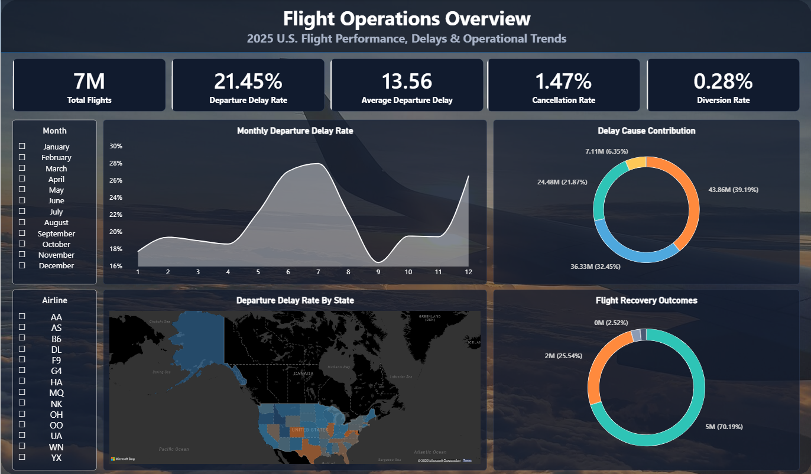
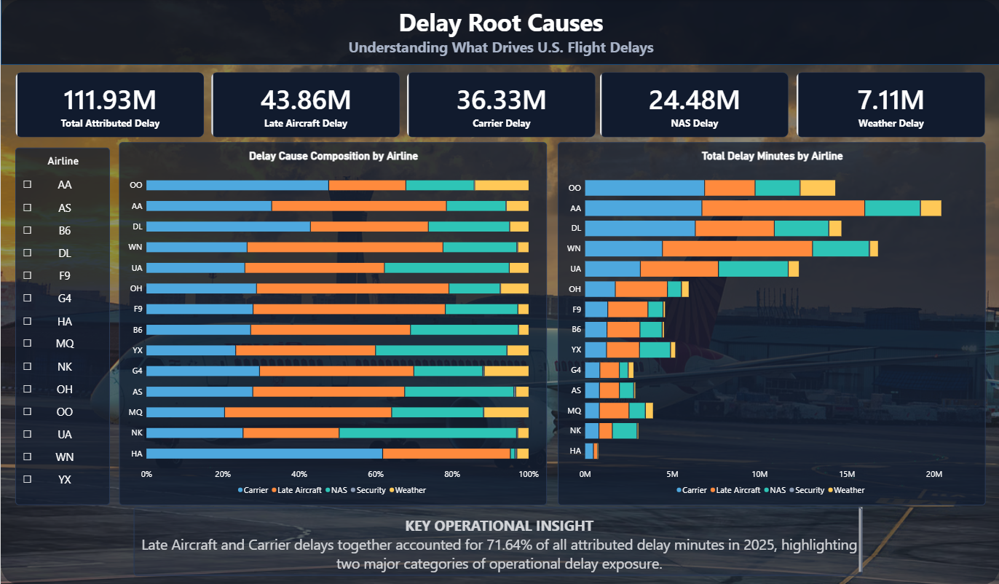
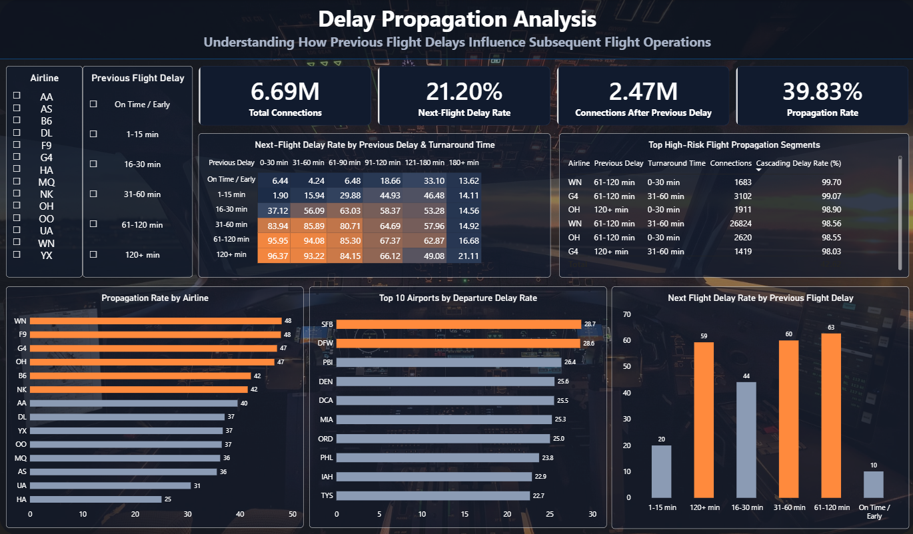
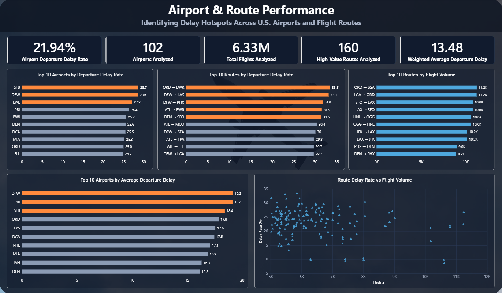

# Flight Delay Propagation Analytics
### End-to-End Data Analytics | Python · PostgreSQL · Power BI

**Analyzing 7 million+ U.S. flight records from 2025 to uncover delay patterns, investigate operational causes, and understand how delays on previous flights relate to subsequent flight performance.**

[📊 Power BI Dashboard](dashboard/Flight_Delay_Propagation_Analytics.pbix) · [📄 Project Report](report/PROJECT_REPORT.md) · [🗃️ SQL Analytical Views](sql/powerbi_views.sql)

---

## Overview

Flight delays create operational challenges across airlines, airports, and connecting flights. Understanding where delays occur, what contributes to them, and how they relate to subsequent flight operations can help reveal patterns that are difficult to identify from individual records.

**Flight Delay Propagation Analytics** is an end-to-end data analytics project built using Python, PostgreSQL, and Power BI. It processes U.S. flight records covering 2025 and transforms them into an interactive, four-page dashboard focused on flight operations, delay causes, delay propagation patterns, and airport and route performance.

The project combines data inspection, ETL, SQL-based analytical views, KPI development, and interactive data visualization in a single workflow.

## Objectives

- Analyze flight operations at the scale of **7 million+ records**.
- Examine departure delays, cancellations, diversions, and attributed delay causes.
- Investigate relationships between previous-flight delays, turnaround times, and subsequent-flight delays.
- Compare airport and route performance using delay rates, average delays, and flight volumes.
- Build reusable SQL views to support business intelligence reporting.
- Communicate operational findings through an interactive Power BI dashboard.

## Technology Stack

| Technology | Application |
|---|---|
| **Python** | Data inspection, cleaning, feature engineering, and ETL |
| **Jupyter Notebook** | Documented analytical workflow |
| **PostgreSQL** | Structured data storage and analytical querying |
| **SQL** | Aggregations, filtering, metric calculations, and analytical views |
| **Power BI** | Interactive dashboards, KPIs, charts, and comparisons |

## Dataset

The project uses U.S. flight performance data covering January–December 2025.

| Database table | Records |
|---|---:|
| `flights_2025` | 7,001,619 |
| `aircraft_sequence_2025` | 6,903,449 |

The main flight table contains **7,001,619 records**. The aircraft sequence table supports analysis of consecutive flight operations.

The source data is not included in this repository. Analytical views can also apply specific eligibility criteria, so their record counts and metrics may differ from the main table.

## Power BI Dashboard

The dashboard is organized into four analytical pages.

### 1. Flight Operations Overview



Provides a high-level view of flight performance, including:

- Total flights: **7,001,619**
- Departure delay rate: **21.45%**
- Average departure delay: **13.56 minutes**
- Cancellation rate: **1.47%**
- Diversion rate: **0.28%**

Monthly trends, delay cause composition, geographic patterns, and recovery outcomes help establish the overall operational picture.

### 2. Delay Root Causes



Examines the distribution of attributed delay minutes across operational categories.

| Delay category | Attributed delay minutes |
|---|---:|
| Late Aircraft | 43.86 million |
| Carrier | 36.33 million |
| National Airspace System (NAS) | 24.48 million |
| Weather | 7.11 million |
| **Total attributed delay minutes** | **111.93 million** |

**Key insight:** Late aircraft and carrier-related delays together account for approximately **71.64%** of attributed delay minutes.

The dashboard compares delay cause composition across airlines and breaks down total delay minutes by cause.

### 3. Delay Propagation Analysis



Investigates how the delay status of a previous flight relates to the delay status of its subsequent flight.

Key metrics:

- Connections analyzed: **6.69 million**
- Next-flight delay rate: **21.20%**
- Connections after a delayed previous flight: **2.47 million**
- Propagation rate: approximately **39.82%**

Visualizations include:

- A heatmap of previous-flight delay severity against turnaround-time buckets.
- Next-flight delay rates across previous-flight delay categories.
- Airline-level propagation comparisons.
- High-risk operational segments.
- Airport departure delay performance.

**Interpretation:** These metrics describe observed relationships in the analyzed connections. They do not establish that a previous delay independently caused a subsequent delay.

### 4. Airport & Route Performance



Compares airport and route performance to identify potential operational hotspots.

The page includes:

- Top 10 airports by departure delay rate.
- Top 10 routes by departure delay rate.
- Top 10 routes by flight volume.
- Top 10 airports by average departure delay.
- A scatter plot comparing route flight volume with departure delay rate.

Considering both delay rates and flight volumes helps distinguish reliability concerns from the scale of operations.

*Airport and route metrics follow the eligibility rules and populations defined in their analytical views.*

## Key Findings

**1. Departure delays affect a substantial share of operations.**  
The overall dashboard reports a departure delay rate of 21.45%.

**2. Late aircraft and carrier-related issues dominate attributed delay minutes.**  
Together, these categories account for approximately 71.64% of attributed delay time.

**3. Previous-flight delays are associated with differences in subsequent-flight performance.**  
The propagation analysis compares delay rates across previous-flight delay categories and turnaround-time buckets.

**4. Airport and route rankings reveal different performance dimensions.**  
Delay rates measure the proportion of delayed departures, while average delays and flight volumes provide additional operational context.

**5. Metric definitions matter.**  
Different dashboard pages use analytical views with specific eligibility rules and denominators. Metrics should therefore be interpreted within their defined populations.

## Project Workflow

```text
U.S. Flight Data — 2025
          ↓
Python Data Inspection & ETL
          ↓
PostgreSQL Data Storage
          ↓
SQL Analytical Views
          ↓
Power BI Data Model & Visualizations
          ↓
Interactive Four-Page Dashboard
```

The workflow separates data preparation, analytical calculations, and dashboard presentation, making the project easier to inspect and extend.

## Repository Structure

```text
Flight-Delay-Propagation-Analysis/
├── notebooks/
│   ├── 01_Flight_Data_Inspection.ipynb
│   └── 02_Flight_ETL_Pipeline.ipynb
├── sql/
│   └── powerbi_views.sql
├── report/
│   └── PROJECT_REPORT.md
├── dashboard/
│   └── Flight_Delay_Propagation_Analytics.pbix
├── screenshots/
│   ├── FL1.png
│   ├── FL2.png
│   ├── FL3.png
│   └── FL4.png
└── README.md
```

## Skills Demonstrated

`Python` · `ETL Pipelines` · `PostgreSQL` · `SQL` · `Data Cleaning` · `Feature Engineering` · `Exploratory Data Analysis` · `KPI Development` · `Power BI` · `Data Visualization` · `Operational Analytics` · `Data Storytelling`

---

## Project Summary

Flight Delay Propagation Analytics demonstrates an end-to-end approach to transforming large-scale flight data into structured analytical datasets and interactive business intelligence reporting.

By combining Python, PostgreSQL, and Power BI, the project explores flight performance, delay attribution, consecutive-flight relationships, and airport and route-level differences within a unified analytics workflow.
